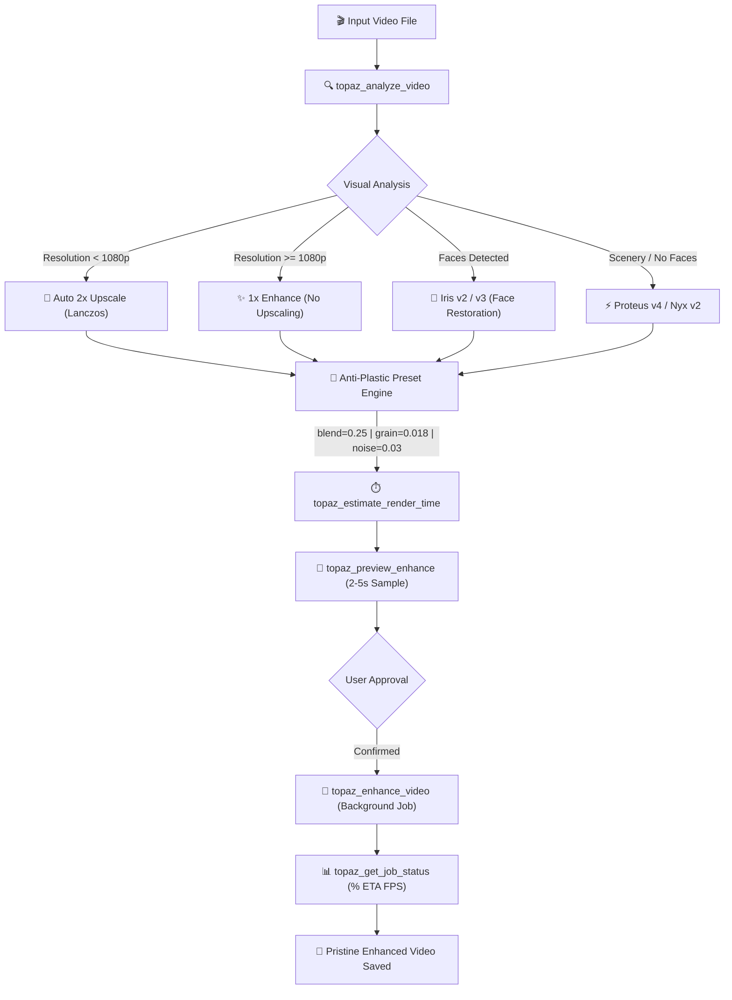

<div align="center">

# 🎬 Topaz Video AI MCP Server

### The Model Context Protocol (MCP) Server for Photorealistic AI Video Upscaling & Autonomous Enhancement

**Empower AI Coding Assistants & Agents (Claude Desktop, Cursor, Antigravity, Windsurf) to analyze frames, auto-detect faces, choose optimal AI models (Iris v2 / Proteus v4), and upscale videos with 100% realistic, non-plastic textures.**

[](https://opensource.org/licenses/MIT)
[](https://www.python.org/)
[](https://modelcontextprotocol.io/)
[](https://www.topazlabs.com/topaz-video-ai)
[](https://ffmpeg.org/)
[](#-the-anti-plastic-philosophy)

<br />

```bash
# Quick Setup for Claude, Cursor, Antigravity, or Any MCP Client
git clone https://github.com/dannymaaz/topaz-video-ai-mcp.git
cd topaz-video-ai-mcp
pip install -e .
```

</div>

---

## 🌟 Overview

**Topaz Video AI MCP Server** connects Large Language Models (LLMs) and autonomous coding agents directly to the state-of-the-art **Topaz Video AI** engine. 

Instead of opening the desktop app and guessing dials manually, your AI agent can now:
1. **Inspect Video Frames:** Extract keyframes and analyze resolution, blur, noise, and face presence using computer vision.
2. **Apply Smart Resolution Rules:** Automatically trigger **2x upscale** for sub-1080p clips (`< 1080p`), or **1x Enhance mode** for clips that are already 1080p+ (avoiding artificial overscaling).
3. **Select the Right Neural Network:** Automatically select **Iris v2** when human faces are present, or **Proteus v4** for high-speed scenery/general footage.
4. **Guarantee Photorealism (Anti-Plastic):** Prevent the notorious "waxy doll" or "CGI plastic face" look with calibrated original texture blending (`blend=0.25`) and micrograin injection.
5. **Headless & Background Execution:** No need to keep the Topaz GUI open. Renders run asynchronously via Topaz's custom hardware-accelerated FFmpeg pipeline (`tvai_up`).

---

## 🎨 The Anti-Plastic Philosophy

Most AI video upscalers produce smooth, artificial results where human skin looks like melted wax or plastic mannequin dolls. 

**Topaz Video AI MCP enforces strict cinema-grade photorealism parameters:**

| Parameter | Standard / Amateur Settings | Topaz Video AI MCP Server Setting | Visual Benefit |
|---|---|---|---|
| **Noise Reduction (`noise`)** | High (`0.30 - 0.70`) | **Ultra-subtle (`0.03 - 0.08`)** | Preserves organic skin pores and natural fabric microtextures. |
| **Texture Blend (`blend`)** | Off (`0.0`) | **`0.20 - 0.28` (25% blend)** | Grounds the AI prediction in real optical camera sensor reality. |
| **Film Micrograin (`grain`)** | Disabled (`0.0`) | **`0.018` (size `1.0`)** | Breaks up digital artificiality and banding for a cinematic finish. |
| **De-halo (`halo`) & Blur (`blur`)** | Aggressive (`0.50+`) | **Balanced (`0.08` halo, `0.25` blur)** | Crisp edges with zero white ringing or neon outlines. |
| **Face Restoration** | Generic Upscale | **Iris v2 / v3 Dedicated Tensor** | Reconstructs eyes, teeth, and natural human micro-expressions. |

---

## ⚙️ Architecture Workflow



---

## 🛠️ MCP Tool Catalog

| Tool Name | Parameters | Description |
|---|---|---|
| `topaz_analyze_video` | `video_path`, `num_samples` | Extracts video metadata, samples frames, detects faces, and scores blur & noise. |
| `topaz_recommend_settings` | `video_path` | Generates the optimal recipe, anti-plastic parameters, and estimated render time. |
| `topaz_estimate_render_time` | `duration_minutes`, `fps`, `model`, `scale_factor` | Returns exact time estimation and highlights faster alternative models. |
| `topaz_preview_enhance` | `video_path`, `start_time_sec`, `duration_sec`, `model`, `scale_factor` | Renders a fast 2-5s preview clip to verify textures before committing to a long render. |
| `topaz_enhance_video` | `video_path`, `output_path`, `model`, `scale_factor`, `start_time_sec`, `duration_sec` | Launches full or trimmed video enhancement in the background. |
| `topaz_get_job_status` | `job_id` | Real-time tracking of render progress (`0-100%`), current frame, FPS, and ETA. |
| `topaz_cancel_job` | `job_id` | Aborts a running render and immediately frees GPU/CPU resources. |
| `topaz_compare_frames` | `video_orig`, `video_enhanced`, `timestamp_sec` | Generates a labeled side-by-side comparison image (*Before vs After*). |
| `topaz_list_models` | None | Lists installed Topaz AI models (`iris-2`, `prob-4`, `nyx-2`, etc.) and their speed ratings. |

---

## 📦 Installation & Setup

### Prerequisites
1. **Topaz Video AI (v5.x or v6.x)** installed on your machine.
   * *Standard Windows Path:* `C:\Program Files\Topaz Labs LLC\Topaz Video AI`
   * *Standard macOS Path:* `/Applications/Topaz Video AI.app/Contents/MacOS`
   * *(Optional)* Set `TOPAZ_APP_DIR` environment variable if installed in a custom location.
2. **Python 3.10+** installed on your system.

### Option 1: Install via Git (Recommended)

```bash
git clone https://github.com/dannymaaz/topaz-video-ai-mcp.git
cd topaz-video-ai-mcp
pip install -e .
```

### Option 2: Run directly with `uv` (Zero-Install)

```bash
uvx --from git+https://github.com/dannymaaz/topaz-video-ai-mcp.git topaz-video-ai-mcp
```

---

## 🔌 Agent Configurations

### 1. Claude Desktop
Add to your `claude_desktop_config.json` (`%APPDATA%\Claude\claude_desktop_config.json` on Windows):

```json
{
  "mcpServers": {
    "topaz-video-ai": {
      "command": "python",
      "args": ["-m", "topaz_video_ai_mcp"],
      "env": {
        "TVAI_MODEL_DIR": "C:\\ProgramData\\Topaz Labs LLC\\Topaz Video AI\\models",
        "TVAI_MODEL_DATA_DIR": "C:\\ProgramData\\Topaz Labs LLC\\Topaz Video AI\\models"
      }
    }
  }
}
```

### 2. Cursor IDE
Add to `.cursor/mcp.json` or Global Cursor Settings:

```json
{
  "mcpServers": {
    "topaz-video-ai": {
      "command": "python",
      "args": ["-m", "topaz_video_ai_mcp"]
    }
  }
}
```

### 3. Google Antigravity / Gemini CLI
Add to `~/.gemini/config/mcp_config.json`:

```json
{
  "mcpServers": {
    "topaz-video-ai": {
      "command": "python",
      "args": ["-m", "topaz_video_ai_mcp"],
      "env": {
        "TVAI_MODEL_DIR": "C:\\ProgramData\\Topaz Labs LLC\\Topaz Video AI\\models",
        "TVAI_MODEL_DATA_DIR": "C:\\ProgramData\\Topaz Labs LLC\\Topaz Video AI\\models"
      }
    }
  }
}
```

---

## 💡 Example Agent Prompts

Once configured, simply chat with your AI agent:

* *"Analiza este video en `C:\Videos\clip.mp4` y dime qué modelo de Topaz recomiendas y cuánto tardará."*
* *"Genera una muestra de 3 segundos del segundo 10 del video para revisar si la piel se ve realista."*
* *"Procesa el video completo en segundo plano escalándolo a x2 con Iris v2 y guárdalo en mi carpeta de salida."*
* *"Genera una imagen comparativa de Antes y Después en el segundo 5 del video renderizado."*
* *"Consulta el progreso y el tiempo restante del trabajo de Topaz."*

---

## ❓ Frequently Asked Questions (FAQ)

#### Do I need to keep the Topaz Video AI desktop application open?
**No.** The MCP server interfaces directly with Topaz's underlying headless AI engine and custom FFmpeg binary (`tvai_up`). Topaz does not need to be open in the taskbar or desktop.

#### What hardware acceleration is used?
The engine automatically leverages hardware acceleration:
- **Intel Graphics / CPUs:** Intel Quick Sync Video (`h264_qsv` / `hevc_qsv`)
- **NVIDIA GPUs:** NVIDIA NVENC (`h264_nvenc` / `hevc_nvenc`)
- **DirectML / OpenVINO:** Utilized by Topaz's internal neural tensor runtimes.

#### How does it handle audio?
Audio tracks are passed through with bit-for-bit lossless copying (`-c:a copy`), ensuring audio never loses synchronization or fidelity.

#### What if my video is already 1080p or 4K?
The MCP automatically detects this and sets **1x Enhance mode** instead of upscaling. This cleans up compression macroblocking and restores sharpness without creating blurry, bloated resolutions.

---

## 📈 Benchmarks (Real-World Reference)

Tested on **Intel Iris Xe Graphics** with 1080p / 720p footage:

| Model | Target Output | Measured Speed | Time for 10-Min Video (30 fps) |
|---|---|---|---|
| **Iris v2 (Faces)** | 2x Upscale | `~0.82 fps` | ~6 hours |
| **Iris v2 (Faces)** | 1x Enhance | `~1.25 fps` | ~4 hours |
| **Proteus v4 (General)** | 2x Upscale | `~1.65 fps` | ~3 hours |
| **Proteus v4 (General)** | 1x Enhance | `~2.20 fps` | ~2.2 hours |
| **Artemis HQ v12** | 2x Upscale | `~2.20 fps` | ~2.2 hours |

---

## 🤝 Contributing & License

Contributions, feature requests, and pull requests are warmly welcomed!
Please feel free to open an issue or submit a PR.

Released under the [MIT License](LICENSE). Copyright © 2026 Topaz Video AI MCP Contributors.
